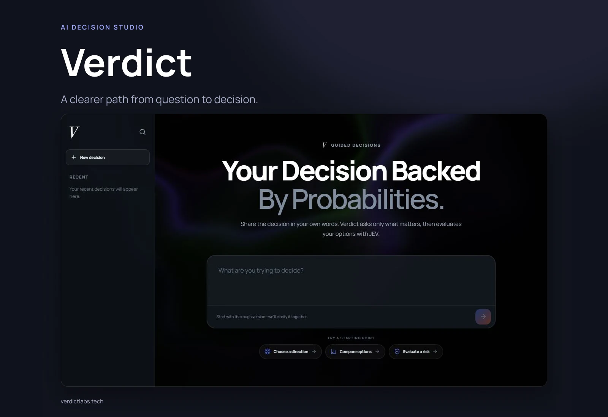

# Verdict — Decision Studio



[Live application](https://www.verdictlabs.tech/)

Verdict is a full-stack decision-support application built with Next.js, React, and TypeScript. It turns an open-ended question into a confirmed decision brief, then compares the available options against explicit criteria and constraints using the JEV decision engine.

## How it works

1. **Discover:** an Ollama Cloud or OpenAI interviewer asks adaptive follow-up questions, with suggested answers and custom input.
2. **Structure:** the app builds a decision brief and identifies missing context.
3. **Confirm:** the user reviews the understanding or revises it through the “What did I miss?” flow.
4. **Architect:** the language model creates candidates, weighted criteria, hard constraints, and typed JEV questions.
5. **Evaluate:** the server evaluates option/criterion and option/constraint pairs, composes their results, and uses an overall Choice question as a disagreement check.
6. **Review:** the interface presents rankings, confidence, criterion scores, constraint checks, and a copyable summary.

Recent conversations are stored in the browser's local storage. They are not a cross-device account history. Outputs depend on the supplied brief and model responses; the app does not guarantee outcomes.

## Stack

- Next.js App Router and React for the interface and server routes
- TypeScript and Zod for structured request/response contracts
- Ollama Cloud and the OpenAI Responses API for interviewing and plan generation
- TypeSafe AI / JEV for probabilistic evaluation
- OGL for the animated background; Lucide for icons
- Vitest and ESLint for verification

## Local development

Use Node.js 20.9 or newer and the package-manager version specified in package.json.

```bash
pnpm install
cp .env.example .env.local
pnpm dev
```

On Windows PowerShell, use `Copy-Item .env.example .env.local`. Open [localhost:3000](http://localhost:3000).

Configure these server-side variables:

- `OLLAMA_API_KEY`: default interviewer
- `TYPESAFE_API_KEY`: JEV evaluation
- `OPENAI_API_KEY`: optional OpenAI interviewer

.env.example documents optional model and base-URL overrides. /api/config reports provider availability without returning keys. Keep .env.local out of version control.

## Code map

- app/page.tsx: interview, confirmation, settings, recent chats, and decision report
- app/api/interview/route.ts: adaptive interview
- app/api/decision/route.ts: plan generation and evaluation
- app/api/config/route.ts: provider configuration status
- lib/llm.ts: Ollama and OpenAI clients
- lib/jev.ts: JEV normalization and HTTP client
- lib/prompts.ts: interview and architect instructions
- lib/schemas.ts and lib/types.ts: validation and shared types

## Verification and production

```bash
pnpm typecheck
pnpm lint
pnpm test
pnpm build
pnpm start
```

Contract tests cover normalization, score/constraint matrices, diagnostic Choice coverage, and response distributions without external inference calls. A production deployment needs the same server-side provider variables as local development.
